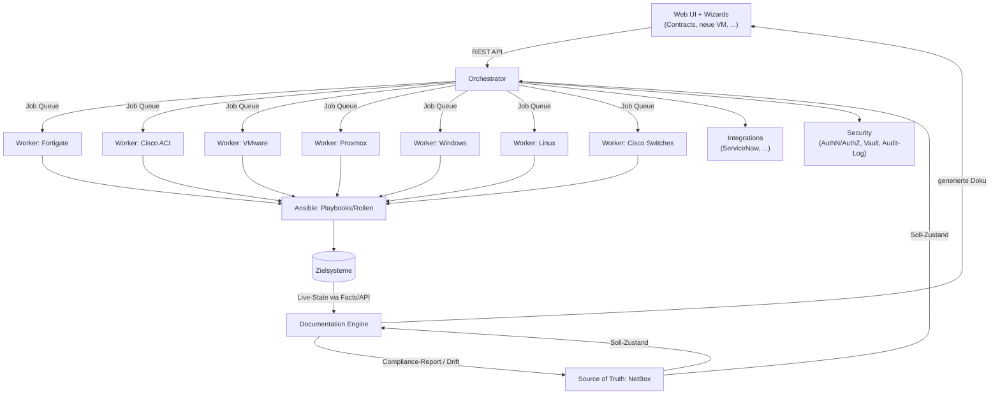

# Architektur

## Grundprinzip

Strikte Microservice-Trennung. Kein Service greift direkt in die Zuständigkeit eines anderen ein –
Kommunikation ausschließlich über definierte APIs bzw. Job-Queue. Das ermöglicht:

- unabhängige Skalierung (v. a. Worker Nodes)
- unabhängiges Deployment/Versionierung je Komponente
- klare Sicherheitsgrenzen (kompromittierter Worker ≠ kompromittierter Orchestrator)
- späteren Umbau von Monorepo → Multi-Repo ohne Architekturänderung

## Übersicht

## Komponenten

### Orchestrator
Zentrale Steuerungseinheit, getrennt von den Workern.
- Nimmt Aufträge vom Web UI entgegen (REST/GraphQL API)
- Verteilt Jobs über eine Queue (z. B. Redis + Celery/RQ, oder RabbitMQ)
- Auth/RBAC-Prüfung, Job-Historie, Audit-Log-Schreibzugriff
- Kennt Worker-Typen, aber führt selbst keine Ansible-Jobs aus
- Empfehlung: Python (FastAPI)

### Worker Nodes
Ein Worker-Typ pro Zielplattform (Fortigate, Cisco ACI, VMware, Proxmox, Windows, Linux, Cisco Switches).
- Horizontal skalierbar – mehrere Instanzen pro Typ möglich
- Führt Ansible-Playbooks/Rollen gegen die jeweilige Zielplattform aus
- Besitzt nur die Credentials/Berechtigungen, die für seine Zielplattform nötig sind (Least Privilege)
- Kommuniziert ausschließlich mit dem Orchestrator (Job annehmen, Ergebnis zurückmelden) – kein direkter Zugriff vom Web UI

### Ansible
Die eigentliche Automatisierungslogik, klar getrennt von Orchestrator und Workern.
- Rollen/Playbooks je Plattform (z. B. `fortinet.fortios`, `cisco.aci`, `community.vmware`,
  `community.general` für Proxmox, `ansible.windows`, `cisco.ios`/`cisco.nxos`)
- Dynamisches Inventory aus NetBox (Source of Truth)
- Wird von Workern aufgerufen, nicht direkt vom Orchestrator

### Source of Truth (NetBox)
- Definiert den Soll-Zustand (Geräte, IPAM, VLANs, VMs, Verkabelung, ...)
- Bestehendes, etabliertes Tool statt Eigenentwicklung
- Liefert Referenzdaten für Compliance-Abgleich und dynamisches Ansible-Inventory

### Documentation Engine
- Erfasst den Live-Zustand der Systeme (Ansible Facts, Vendor-APIs)
- Generiert automatisch Dokumentation daraus
- Vergleicht Live-Zustand mit Source of Truth → Compliance-/Drift-Reports
- Komplett getrennt vom Automatisierungs-Pfad (rein lesend gegenüber Zielsystemen)

### Web UI
- Bedienoberfläche + Wizards für wiederkehrende Aufgaben (Contract-Erfassung, neue VM, ...)
- Spricht ausschließlich mit dem Orchestrator, nie direkt mit Workern oder Zielsystemen
- Container, unabhängig deploybar

### Integrations
- Anbindung externer Systeme (ServiceNow, ggf. Monitoring/Ticketing/CMDB)
- Eigene, austauschbare Connector-Module

### Security
- Secrets-Management (Start: Ansible Vault, Ausbau: HashiCorp Vault)
- mTLS/Verschlüsselung auch intern zwischen Orchestrator ↔ Worker
- RBAC auf Web-UI- und API-Ebene
- Lückenloses Audit-Log: wer hat wann was ausgelöst/geändert
- Least-Privilege-Service-Accounts pro Zielplattform

## Tech-Stack (Empfehlung, Start-Setup)

| Bereich | Wahl | Begründung |
|---|---|---|
| Orchestrator/API | Python, FastAPI | Async, gute Ansible-/NetBox-Anbindung, Typisierung |
| Job Queue | Redis + Celery oder RQ | Bewährt, einfach zu betreiben |
| Automatisierung | Ansible | Von dir vorgegeben, riesiges Vendor-Ökosystem |
| Source of Truth | NetBox | Etablierter Standard, REST/GraphQL-API vorhanden |
| Documentation Engine | Python + MkDocs (Material) | Doku als Code, versionierbar |
| Web UI | React/Vue + schlankes BFF | Trennung Frontend/Backend |
| Deployment (Start) | Docker Compose | Niedrige Einstiegshürde |
| Deployment (Ausbau) | Kubernetes | Für Multi-Worker-Skalierung |
| Secrets | Ansible Vault → später HashiCorp Vault | Wachstumspfad |
